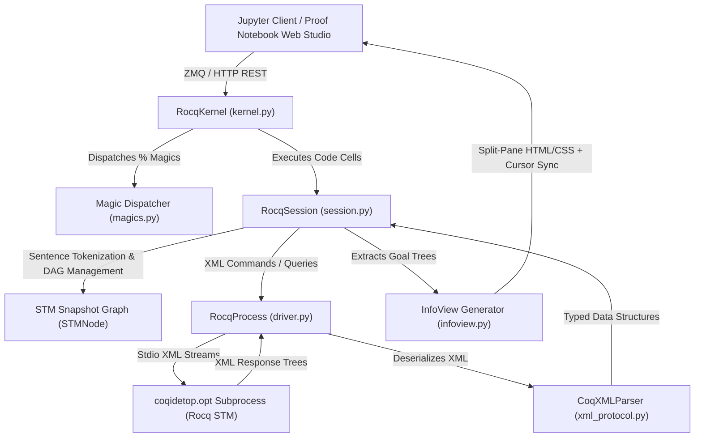

# Dedicated Rocq (Coq) Jupyter Kernel with STM State Backtracking and InfoView Goal Inspection

*   **Author:** 이인수
*   **Status:** Approved
*   **Date:** 2026-11-12

--------------------------------------------------------------------------------

## Overview

This project introduces a dedicated Rocq (formerly Coq) Jupyter kernel (`rocq_kernel`) to `proof-notebook`. The kernel communicates with a persistent Rocq background process to manage proof sessions through Rocq's State Transaction Manager (STM). It executes formal proof code cell-by-cell and sentence-by-sentence, maintains an immutable state snapshot tree that automatically rolls back upon syntax or tactic failures, and renders an interactive Split-Pane InfoView displaying active proof goals, hypotheses, and diagnostic feedback synchronized with editor cursor movement.

## The Problem

`proof-notebook` currently provides an interactive notebook theorem proving environment exclusively for Lean 4 via `leanprover-community/repl`. Formal verification engineers and researchers working in Rocq (Coq) lack an equivalent modern Jupyter environment. Existing Coq notebook integrations (such as legacy `coq_jupyter`) exhibit several critical deficiencies:

1. **Lack of Fine-Grained STM State Backtracking**: When a cell fails or when a user edits an earlier cell, existing kernels either fail to clean up internal state, require restarting the entire kernel process, or cannot branch cleanly from the state immediately preceding the modified sentence.
2. **Missing Interactive InfoView**: Proof states in existing Coq kernels are printed as raw plaintext stdout blocks. There is no structured, split-pane InfoView comparing goals before and after tactics, displaying multiple subgoals, or tracking term types at cursor positions.
3. **No Hybrid Editor Cursor Synchronization**: Users cannot click across lines in code cells or move their CodeMirror editor cursor to inspect intermediate proof states at each sentence boundary.
4. **Disjoint Multi-Prover Experience**: Users must switch between disparate tools rather than utilizing a cohesive platform with unified magics (`%load`, `%goals`, `%undo`, `%reset`), consistent keyboard shortcuts (`Shift+Tab` signature inspection, backslash Unicode completion), and Project-Agora R&D workbench integration.

## Goals

*   **Goal 1: Dedicated Rocq Jupyter Kernel**: Provide a standalone `rocq` / `coq` kernelspec powered by `ipykernel` that integrates cleanly into JupyterLab, Classic Notebook, and the Proof Notebook Web Studio.
*   **Goal 2: Persistent STM State Management & Auto-Backtracking**: Implement a persistent Rocq process manager that tracks Rocq STM state IDs (`Stateid.t`), enforces atomic rollback on sentence/cell failure, and branches cleanly when earlier cells are re-executed.
*   **Goal 3: Interactive Split-Pane InfoView**: Extract structured proof goals (focused goals, shelved goals, admitted goals, hypotheses) and render them in the project's theme-adaptive Split-Pane InfoView widget with turnstile (`⊢`) highlighting.
*   **Goal 4: Editor Cursor Synchronization**: Bind editor cursor movements in CodeMirror 5, CodeMirror 6, and native textareas to update the active sentence and display the corresponding proof state in the InfoView.
*   **Goal 5: Kernel Magics & Productivity Utilities**: Implement line and cell magics (`%goals`, `%undo`, `%reset`, `%load`, `%project`) and Unicode math symbol tab-completion for Rocq.
*   **Goal 6: Comprehensive Test Harness**: Implement unit tests with mock Rocq processes for offline CI execution, alongside live integration tests conditional on system Rocq toolchain presence.

## Non-Goals

*   **Non-Goal 1: Automatic OCaml/opam Environment Bootstrapping**: The kernel will not attempt to install or manage OCaml, opam switches, or Coq binaries from PyPI. The host system must provide a working `rocq` or `coq` installation on `PATH` (or specified via environment variable).
*   **Non-Goal 2: General Language Server Protocol (LSP) Replacement**: The kernel is not intended to replace full-featured IDE extensions (e.g., VsCoq, Coqtail) for multi-file project refactoring, workspace-wide symbol renaming, or document outline navigation.
*   **Non-Goal 3: Cross-Prover AST or Term Translation**: The kernel will not translate proof scripts or terms between Lean 4 and Rocq.
*   **Non-Goal 4: Custom Kernel C Extensions**: The kernel will be written entirely in pure Python, communicating with official Rocq executables over standard IPC (stdio/XML/S-expressions/sockets).

## Open Questions

*   **Question 1 (Backend IPC Protocol)**: Should the driver use `coqidetop` XML protocol, `SerAPI` (S-expressions), `coq-lsp` / `vscoq` (LSP/JSON-RPC), or a lightweight standalone OCaml REPL binary similar to `leanprover-community/repl`?
*   **Question 2 (Cell Execution Atomicity)**: If a cell contains multiple Rocq sentences (e.g., `intro x. induction x. reflexivity.`) and sentence 2 fails, should the kernel roll back the entire cell atomically to the pre-cell state, or commit sentence 1 and halt at sentence 2?
*   **Question 3 (Repository Core Refactoring)**: Should shared components (InfoView HTML/CSS/JS generator, CodeMirror cursor hooks, abstract snapshot DAG, and Web Studio server) be refactored into a common `src/proof_notebook_core` package to serve both `lean4_kernel` and `rocq_kernel` without code duplication?

## Critical User Journeys (CUJs)

### CUJ 1: Interactive Tactic Proof Execution
*   **Given**: A Jupyter notebook session running the `rocq` kernel with an established theory context.
*   **When**: The user defines a lemma `Lemma add_0_r : forall n : nat, n + 0 = n.` followed by `Proof. intros n. induction n as [| n' IHn].` in a cell.
*   **Then**: The kernel commits the declarations via STM, detects 2 generated subgoals (`n = 0` base case and `S n' + 0 = S n'` inductive step), and renders the Split-Pane InfoView displaying both subgoals with active turnstiles and hypotheses.

### CUJ 2: Failure Rollback & Auto-Backtracking
*   **Given**: An active Rocq session with definitions established in preceding cells at STM state $S_k$.
*   **When**: The user executes a cell containing an erroneous tactic `exact 0.` that fails unification.
*   **Then**: The kernel intercepts the failure message, automatically reverts the STM state to $S_k$, renders an error card with diagnostic feedback, and ensures subsequent cells continue execution from state $S_k$ without state corruption.

### CUJ 3: Multi-Prover Web Studio Integration
*   **Given**: The Proof Notebook Web Studio running with dual Lean 4 and Rocq kernel support.
*   **When**: The user selects a `.v` or `.ipynb` workspace configured with Rocq and edits a proof cell.
*   **Then**: The editor cursor movement dynamically queries the sentence boundaries within the cell and updates the right-hand InfoView pane to reflect the exact goal state at the cursor position.

--------------------------------------------------------------------------------

## Technical Plan (Architecture)

### 1. High-Level System Architecture

The Rocq integration introduces a standalone kernel engine package (`src/rocq_kernel/`) alongside `src/lean4_kernel/`, sharing common Jupyter/Web Studio frontend display contracts. The architecture is organized around four core layers:



---

### 2. Subsystem Components & Responsibilities

| Subsystem Module | Path | Primary Responsibility |
| :--- | :--- | :--- |
| **Process Driver** | `src/rocq_kernel/driver.py` | Spawns and manages persistent `coqidetop.opt` subprocesses over standard I/O. Handles process lifecycle, XML framing, thread-safe command locking, query timeouts, and graceful shutdown. |
| **XML Protocol Parser** | `src/rocq_kernel/xml_protocol.py` | Encodes Python requests into Coq XML payloads (`<call val="...">`) and decodes recursive Coq XML trees (`<value val="good">`, `<goals>`, `<hyp>`, `<richpp>`) into typed Python dataclasses. |
| **Session & STM Manager** | `src/rocq_kernel/session.py` | Sentence tokenizer, immutable STM state DAG, transaction boundary manager, error rollback (`Edit_at`), and cell re-execution auto-backtracking. |
| **InfoView Parser & Renderer** | `src/rocq_kernel/infoview.py` | Extracts focused goals, shelved goals, admitted goals, and hypotheses from STM responses, formatting them into the project's high-contrast Split-Pane InfoView widget with CodeMirror cursor hooks. |
| **Kernel Implementation** | `src/rocq_kernel/kernel.py` | Subclasses `ipykernel.kernelbase.Kernel`. Implements `do_execute`, `do_complete`, `do_inspect` (`Check` / `Print`), `do_is_complete`, and handles `%goals`, `%undo`, `%reset` magics. |
| **Unicode & Lexicon Map** | `src/rocq_kernel/unicode_map.py` | Mapping table for Rocq mathematical Unicode tab completions (`\forall` $\to \forall$, `\exists` $\to \exists$, `\to` $\to \to$, `\/` $\to \lor$, `/\` $\to \land$, `~` $\to \neg$) and keywords/tactics. |
| **Web Studio Dual Kernel** | `src/lean4_kernel/web.py` (updated) | Updates `ProofKernelPool` to detect and manage `rocq` / `coq` kernel instances, routing cell execution and lifecycle management seamlessly across both Lean 4 and Rocq workspaces. |
| **CLI & Install Manager** | `src/rocq_kernel/install.py` | Provides `rocq-kernel install` and `rocq-kernel doctor` to register the `rocq` / `coq` kernelspec and inspect system binary health. |

---

### 3. XML Communication Protocol Contract (`coqidetop.opt`)

Communication with `coqidetop.opt` adheres to Coq's native XML protocol over standard I/O:

#### 3.1 Initial Handshake (`Init`)
The kernel sends:
```xml
<call val="Init"><option val="none"/></call>
```
The driver receives the root `state_id` (Coq 8.14+ / Rocq 9.x emits `<state_id>`, parser supports both `<state_id>` and `<stateid>`):
```xml
<value val="good"><state_id val="1"/></value>
```

#### 3.2 Adding a Sentence (`Add`)
Each sentence is wrapped and submitted with its parent state ID and edit ID:
```xml
<call val="Add">
  <pair>
    <pair><pair><pair><string>Lemma add_comm : forall n m : nat, n + m = m + n.</string><int>1</int></pair><pair><state_id val="1"/><bool val="true"/></pair></pair><int>0</int></pair><pair><int>1</int><int>0</int></pair>
  </pair>
</call>
```
Success response returns the new state ID and optional status:
```xml
<value val="good">
  <pair><state_id val="2"/><union val="in_l"><unit/></union></pair>
</value>
```

#### 3.3 Querying Proof Goals (`Goal`)
When inside a proof, the kernel queries active goal states:
```xml
<call val="Goal"><unit/></call>
```
The response returns focused goals, background goals, shelved goals, and admitted goals:
```xml
<value val="good">
  <option val="some">
    <goals>
      <list>
        <!-- Focused Goals -->
        <goal>
          <string>2</string>
          <list>
            <!-- Hypotheses: n : nat, m : nat -->
            <hyp><list><string>n</string><string>m</string></list><option val="none"/><string>nat</string></hyp>
          </list>
          <string>n + m = m + n</string>
        </goal>
      </list>
      <list/><list/><list/>
    </goals>
  </option>
</value>
```

#### 3.4 State Backtracking (`Edit_at`)
To roll back or branch from an earlier point in the proof:
```xml
<call val="Edit_at"><state_id val="1"/></call>
```
The STM immediately cleans up subsequent states and resets its active pointer.

---

### 4. Sentence Tokenization & Cell Execution Lifecycle

Rocq requires sentence-level granularity delimited by periods (`.`) followed by whitespace or EOF, while ignoring periods inside strings (`"..."`) or comments (`(* ... *)`).

```text
Cell Source:
  "Definition double (n : nat) : nat := n + n.
   Lemma double_zero : double 0 = 0.
   Proof. reflexivity. Qed."
      ↓
Sentence Tokenizer:
  1. "Definition double (n : nat) : nat := n + n."
  2. "Lemma double_zero : double 0 = 0."
  3. "Proof."
  4. "reflexivity."
  5. "Qed."
```

#### Execution Steps Per Cell:
1. **Sentence Parsing**: The cell source is sliced into discrete sentences with precise source line/column coordinates.
2. **Sequential Transaction Commit**:
   - For sentence $i$, the kernel issues `Add` with parent state $S_{i-1}$.
   - If successful, the new state $S_i$ is recorded in the session's `STMNode` DAG.
   - If sentence $i$ fails with a compile or tactic error:
     - The kernel intercepts the `<value val="fail">` message.
     - Automatically issues `Edit_at` targeting the last valid state (either $S_{i-1}$ or the pre-cell state $S_0$).
     - Halts execution of remaining sentences in the cell, renders an actionable error card, and preserves $S_{i-1}$ as the active environment state.
3. **Goal State Extraction**: At the conclusion of the cell (or active proof sentence), the kernel issues `Goal` to update the active proof status.
4. **Auto-Backtracking on Cell Re-execution**: When cell $C$ is modified and re-executed, `RocqSession` checks the root state ID recorded prior to cell $C$'s previous execution. It issues `Edit_at` targeting that ancestor state ID, pruning invalid descendants and committing the newly edited sentences cleanly.

---

### 5. Split-Pane InfoView Integration for Rocq

The InfoView widget adapts the project's high-contrast theme styling to Rocq's proof data model:
- **Left Pane (Code & Line Badges)**:
  - Displays Rocq source code with line numbers.
  - Per-sentence status badges: `✓` for completed proofs (`Qed`), `2 goals` for open branching tactics, `shelved` for deferred goals, and `error` for failed sentences.
- **Right Pane (Goals & Inspection)**:
  - **Focused Goals (`⊢ Conclusion`)**: Renders active hypotheses above turnstile $\vdash$, followed by conclusion formula.
  - **Shelved / Admitted Goals**: Explicitly flagged in amber badges to warn users of incomplete proof obligations.
  - **Cursor Synchronization**: Listens to CodeMirror selection events. Identifies which sentence encloses the cursor position `(line, col)` and updates the InfoView to show the exact goal state after that sentence.

---

### 6. Multi-Prover Integration in Web Studio (`src/lean4_kernel/web.py`)

`ProofKernelPool` in `src/lean4_kernel/web.py` is extended to support Rocq alongside Lean 4 and Python:
- Cell execution routes to `rocq_kernel` when `cell.language in ("rocq", "coq")`.
- UI cell toolbar dropdown includes `∀ Lean 4 (Proof)`, `🐓 Rocq (Proof)`, `🐍 Python 3 (Code)`, and `¶ Markdown (Text)`.
- Workspace persistence automatically saves and mounts multi-prover cells in Redis HOT state.

--------------------------------------------------------------------------------

## Alternatives Considered

### Alternative A: `SerAPI` (`sertop`) S-Expression Protocol

*   **Mechanism**: Spawns `sertop` and interacts using OCaml S-expressions (sexps) with structured AST node tagging.
*   **Pros**: Highly structured, expressive, and provides clean machine-readable serialization for Coq terms and proof trees.
*   **Cons**: `coq-serapi` is an external opam library not packaged with standard Coq distributions. Installing it requires an active `opam` switch and compiler matching.
*   **Reason for Rejection**: `Rejected by author: Mandating SerAPI would impose an external opam dependency on users running standard system or distribution-packaged Coq installations, breaking out-of-the-box zero-dependency usability.`

### Alternative B: Language Server Protocol via `vscoq-language-server` or `coq-lsp` (JSON-RPC)

*   **Mechanism**: Connects over JSON-RPC following the Language Server Protocol (LSP), synchronizing virtual document buffers and receiving diagnostic/goal push notifications.
*   **Pros**: Standard JSON-RPC framing identical to modern editor extensions; avoids parsing Coq XML schemas directly.
*   **Cons**: LSP is document-oriented and asynchronous, designed for full-file editing with diagnostics delivered over push notifications rather than synchronous execution of discrete notebook cells. Additionally, it requires separate language server binaries that are not bundled with standard Coq installations.
*   **Reason for Rejection**: `Rejected by author: LSP's asynchronous notification model adds significant race-condition complexity when coordinating sequential notebook cell execution, and requires separate language server binaries not present in base Coq installations.`

### Alternative C: Synchronous Batch CLI Invocation (`coqc` per cell)

*   **Mechanism**: Re-runs `coqc` on all concatenated preceding cells whenever a cell is executed.
*   **Pros**: Simple to implement without managing persistent background processes or parsing XML communication protocols.
*   **Cons**: Lacks state persistence; every cell execution recompiles all preceding code from scratch, resulting in quadratic $O(N^2)$ compilation latency. Cannot support interactive tactic exploration, step-by-step goal inspection, or cursor synchronization.
*   **Reason for Rejection**: `Rejected by author: Batch compilation per cell causes severe performance degradation on non-trivial proofs and completely prevents interactive sentence-by-sentence tactic exploration and InfoView inspection.`

--------------------------------------------------------------------------------

## Detailed Implementation Plan

### Target Files to Create/Modify

#### 1. `src/rocq_kernel/__init__.py` (Create)
*   **Type / Scope**: Python Module Package Header
*   **Proposed Changes**: Initialize the `rocq_kernel` package, expose package version (`__version__ = "0.1.0"`), and export core classes: `RocqKernel`, `RocqSession`, `RocqProcess`.

#### 2. `src/rocq_kernel/__main__.py` (Create)
*   **Type / Scope**: Python Execution Entrypoint
*   **Proposed Changes**: Expose `if __name__ == "__main__":` entrypoint invoking `IPKernelApp.launch_instance(kernel_class=RocqKernel)`, allowing launch via `python -m rocq_kernel`.

#### 3. `src/rocq_kernel/xml_protocol.py` (Create)
*   **Type / Scope**: XML Protocol Encoder & Decoder
*   **Proposed Changes**: Implement a dedicated XML parser and serializer for the `coqidetop` XML protocol:
    *   `build_init_call() -> str`: Encodes `<call val="Init"><option val="none"/></call>`.
    *   `build_add_call(sentence: str, edit_id: int, state_id: int) -> str`: Encodes `<call val="Add">` with CDATA/escaped sentence text.
    *   `build_edit_at_call(state_id: int) -> str`: Encodes `<call val="Edit_at"><stateid val="..."/></call>`.
    *   `build_goal_call() -> str`: Encodes `<call val="Goal"><unit/></call>`.
    *   `parse_xml_response(xml_bytes: bytes) -> RocqValue`: Recursive decoder extracting typed `RocqGoal` (id, hypotheses, conclusion), `RocqHypothesis` (identifiers, value, type), `RocqFeedback` (state, message severity, string), and error payloads (`<value val="fail">`).

#### 4. `src/rocq_kernel/driver.py` (Create)
*   **Type / Scope**: Persistent Subprocess Driver
*   **Proposed Changes**: Implement `RocqProcess`:
    *   Binary discovery: Inspects `ROCQ_BIN`, `COQIDETOP_BIN`, `coqidetop.opt`, and `coqidetop` on `PATH`.
    *   Process management: Spawns the subprocess with unbuffered standard streams and process group isolation.
    *   Thread-safe request/response locking with timeout enforcement (`threading.Lock` and `poll`).
    *   Lifecycle methods: `start()`, `send_call(xml_req: str, timeout: float) -> RocqValue`, `interrupt()`, `kill()`.

#### 5. `src/rocq_kernel/session.py` (Create)
*   **Type / Scope**: Stateful Session & STM DAG Manager
*   **Proposed Changes**: Implement `RocqSession`:
    *   `tokenize_sentences(code: str) -> list[SentenceSpan]`: Parses Rocq code into sentences delimited by `.` followed by whitespace or EOF, respecting comments `(* ... *)` and double-quoted string literals `"..."`.
    *   `STMNode`: Dataclass tracking `state_id: int`, `parent_state_id: int | None`, `sentence: str`, `cell_id: str | None`, and resulting goals.
    *   `execute_command(code: str, cell_id: str | None = None) -> RocqExecutionOutcome`: Executes each sentence sequentially via `Add`. On sentence failure, catches error and issues `Edit_at` back to the pre-cell or pre-sentence state.
    *   `auto_backtrack(cell_id: str)`: When re-executing an earlier cell, queries the DAG for the ancestor state before the cell's initial sentence and resets the STM via `Edit_at`.

#### 6. `src/rocq_kernel/infoview.py` (Create)
*   **Type / Scope**: Interactive InfoView Widget Generator
*   **Proposed Changes**: Implement `render_rocq_infoview_html(payload: RocqInfoViewPayload) -> str`:
    *   Left pane: Line numbers, Rocq source code, and per-sentence badges (`✓`, `N goals`, `shelved`, `error`).
    *   Right pane: Focused goals with hypothesis context and turnstile `⊢`, shelved goals, and diagnostic messages.
    *   Hybrid cursor synchronization script: Binds to CodeMirror 5/6 and textarea cursor events, mapping `(line, col)` to the enclosing sentence and displaying the active proof state.
    *   Server-Side Rendering (SSR) fallback: Pre-populates static HTML inside `.l4iv-info-pane` for static export and no-JS previewers.

#### 7. `src/rocq_kernel/kernel.py` (Create)
*   **Type / Scope**: Jupyter Kernel Implementation
*   **Proposed Changes**: Subclass `ipykernel.kernelbase.Kernel`:
    *   Set kernel metadata: `implementation = "rocq_kernel"`, `language = "coq"`, `language_info = {"name": "coq", "file_extension": ".v", "mimetype": "text/x-coq"}`.
    *   `do_execute`: Dispatches line/cell magics or executes through `self.rocq_session.execute_command` (named `rocq_session` to avoid collision with IPython Kernel `session` Traitlet), formatting output via `render_rocq_infoview_html`.
    *   `do_complete`: Computes backslash Unicode math symbol completions (e.g. `\forall` $\to \forall$) and keyword completions.
    *   `do_inspect`: Executes non-mutating `Check <symbol>.` or `Print <symbol>.` via `Query` and formats the signature in the hover popover.
    *   `do_is_complete`: Verifies bracket/comment matching and checks if input terminates with `.`.

#### 8. `src/rocq_kernel/unicode_map.py` (Create)
*   **Type / Scope**: Unicode Abbreviation & Keyword Dictionaries
*   **Proposed Changes**: Define dictionary of 100+ Rocq/Coq mathematical symbols and notations (`\forall` $\to \forall$, `\exists` $\to \exists$, `\to` $\to \to$, `\/` $\to \lor$, `/\` $\to \land$, `~` $\to \neg$, `\le` $\to \le$, `\ge` $\to \ge$, `\nat` $\to \mathbb{N}$, `\bool` $\to \mathbb{B}$) and syntax keywords (`Definition`, `Lemma`, `Theorem`, `Proof`, `Qed`, `induction`, `intros`, `simpl`, `reflexivity`).

#### 9. `src/rocq_kernel/install.py` (Create)
*   **Type / Scope**: CLI Management Utility
*   **Proposed Changes**: Implement `install_kernelspec(user: bool, prefix: str | None)` and `run_doctor()`:
    *   Registers `kernelspec` named `rocq` with display name `"Rocq (Coq)"` and language `"coq"`.
    *   Validates presence of `coqidetop.opt` or `coqidetop` on system `PATH` and reports binary version.

#### 10. `src/rocq_kernel/README.md` (Create)
*   **Type / Scope**: Architecture & Contract Documentation
*   **Proposed Changes**: Document `src/rocq_kernel` module hierarchy, state invariants, XML protocol schemas, and testing guidelines under the Elephant-Goldfish Model (EGM).

#### 11. `src/lean4_kernel/web.py` (Modify)
*   **Type / Scope**: Web Studio Multi-Kernel Manager
*   **Proposed Changes**:
    *   Update `ProofKernelPool`: Add support for language `"rocq"` / `"coq"`, spawning `rocq_kernel` instances in the kernel pool alongside `lean4` and `python`.
    *   Update workspace serialization: Save and restore Rocq cells within workspace JSON documents.

#### 12. `src/lean4_kernel/static/app.js` (Modify)
*   **Type / Scope**: Web Studio Frontend Controller
*   **Proposed Changes**:
    *   Update cell language dropdown options to include `🐓 Rocq (Coq)`.
    *   Add syntax placeholder text: `(* Rocq (Coq) 증명 또는 정의를 입력하세요 (예: Lemma, Definition, Proof. ... Qed.) *)`.
    *   Update cursor status display and keyboard shortcut bindings for Rocq cells.

#### 13. `pyproject.toml` (Modify)
*   **Type / Scope**: Packaging Configuration
*   **Proposed Changes**:
    *   Add console script entrypoint: `rocq-kernel = rocq_kernel.install:main`.
    *   Add keywords: `"rocq"`, `"coq"`, `"formal-verification"`.

#### 14. `tests/test_rocq_protocol.py` (Create)
*   **Type / Scope**: Unit Test Suite (Offline / Pure Python)
*   **Proposed Changes**:
    *   Test sentence tokenization: edge cases with comments `(* ... *)`, string literals `"a. b."`, and trailing whitespace.
    *   Test XML encoding and decoding: validating tree construction and extraction of `RocqGoal` and `RocqHypothesis`.
    *   Test mock driver: mock subprocess simulating `coqidetop` XML streams, testing timeout handling, crash recovery, and `Edit_at` rollback without requiring a real Rocq installation.

#### 15. `tests/test_rocq_session.py` (Create)
*   **Type / Scope**: Integration Test Suite
*   **Proposed Changes**:
    *   Decorated with `@pytest.mark.skipif(not has_rocq, reason="Requires runnable coqidetop")`.
    *   Test live session execution of definitions (`Definition plus2 (n : nat) := n + 2.`).
    *   Test proof state transitions through inductive proofs (`Lemma plus_O_n : forall n, 0 + n = n.`).
    *   Test auto-backtracking when re-evaluating preceding cells.

#### 16. `examples/Arithmetic.v` (Create)
*   **Type / Scope**: Formal Proof Sample Module
*   **Proposed Changes**: Provide standard arithmetic definitions and inductive proofs (e.g. associativity and commutativity of addition over `nat`) demonstrating clean, un-admitted proofs for `%load` file-mode importing.

#### 17. `notebooks/rocq_demo.ipynb` (Create)
*   **Type / Scope**: Demonstration Notebook
*   **Proposed Changes**: Provide a multi-cell Jupyter notebook configured with the `rocq` kernelspec, showcasing definitions, proof scripts, interactive split-pane InfoViews, and state rollback.

---

### Verification Plan

*   **Static Analysis & Linting**:
    *   Run `ruff check src/rocq_kernel tests/test_rocq_*.py` ensuring 0 linting errors and clean PEP 8 compliance.
*   **Offline Protocol Unit Tests**:
    *   Run `pytest tests/test_rocq_protocol.py -v`. Must pass 100% in pure Python without system Coq dependencies.
*   **Live Session & E2E Verification**:
    *   Run `pytest tests/test_rocq_session.py -v` in environments with `coqidetop` installed.
*   **Kernelspec Registration**:
    *   Execute `rocq-kernel install --user` and verify presence via `jupyter kernelspec list`.
    *   Execute `rocq-kernel doctor` to verify system binary diagnostics.
*   **Web Studio Dual-Kernel Verification**:
    *   Launch `lean4-kernel serve` and create a workspace containing both Lean 4 and Rocq cells, confirming that cell execution, InfoView rendering, and Redis HOT state persistence operate seamlessly across both languages.
