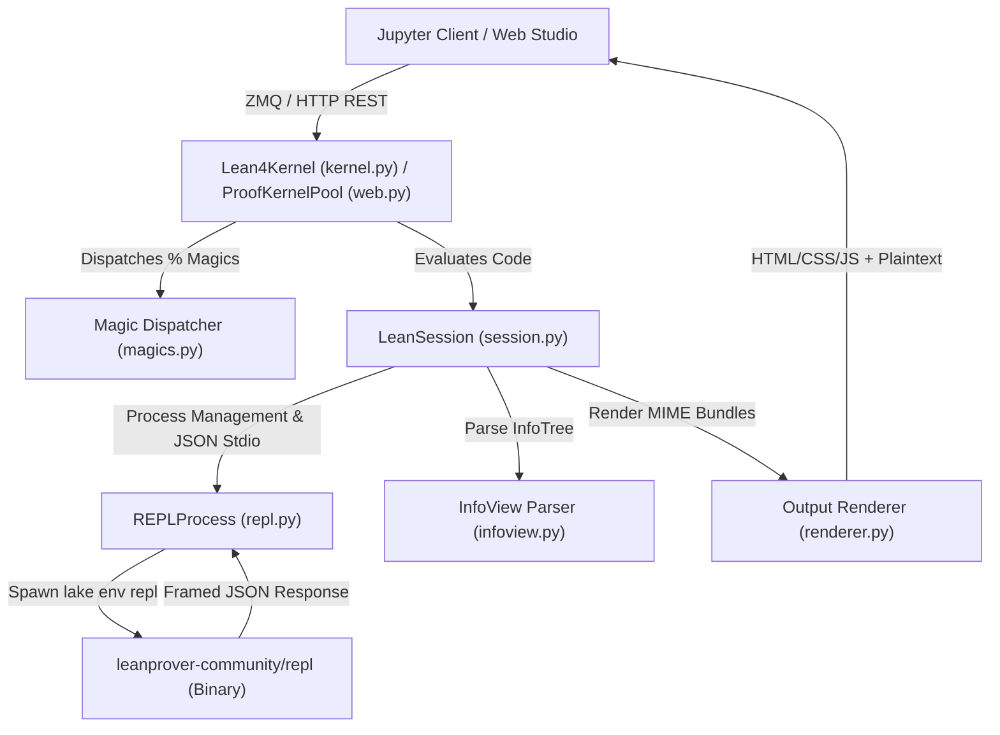

# Lean 4 Jupyter Kernel Engine (`src/lean4_kernel`)

The `lean4_kernel` package implements the core runtime engine for the Lean 4 Jupyter Kernel and the standalone Proof Notebook Studio. It manages persistent `leanprover-community/repl` sub-processes, orchestrates an immutable environment/proof-state Directed Acyclic Graph (DAG), translates Lean 4 `InfoTree`s into interactive widgets, and provides dual-language (Lean 4 + Python) execution pools.

---

## 1. Architecture & Component Interaction



---

## 2. Module Directory

| Module | Primary Responsibility | Key Classes & Functions |
| :--- | :--- | :--- |
| `repl.py` | Subprocess lifecycle, JSON framing (`\n\n`), toolchain version matching, sysroot caching | `REPLProcess`, `REPLBinaryManager`, `parse_repl_json_block`, `resolve_lean_sysroot`, `detect_lean_version`, `extract_version_tag`, `strip_leading_lean_comments`, `starts_with_header_import` |
| `session.py` | Stateful Lean 4 session manager, immutable snapshot graph, smart backtracking, crash recovery | `LeanSession`, `EnvNode`, `ProofNode`, `ExecutionOutcome`, `SessionConfig` |
| `infoview.py` | `InfoTree` parser (`TacticInfo` + `TermInfo`), split-pane widget generator, scrollable containers, `↕ Expand` toggle, CodeMirror 5/6 & DOM cursor synchronizer | `InfoViewPayload`, `TacticStepInfo`, `TermItemInfo`, `extract_infoview_payload`, `render_infoview_html` |
| `magics.py` | Kernel line (`%`) and cell (`%%`) magic command parser and dispatcher | `dispatch_magic`, `is_magic_cell`, `MagicResult`, `MAGIC_NAMES` |
| `renderer.py` | Theme-adaptive Jupyter MIME bundle formatter (`text/plain`, `text/html`) with syntax highlighting | `render_outcome`, `render_text_card` |
| `unicode_map.py`| Lean 4 Unicode tab-completion table (150+ math symbols) and keyword/tactic lexicons | `UNICODE_ABBREVIATIONS`, `LEAN4_KEYWORDS`, `LEAN4_TACTICS` |
| `kernel.py` | `ipykernel.kernelbase.Kernel` implementation for Jupyter/VS Code protocols | `Lean4Kernel` |
| `web.py` | VS Code-style Web Workbench server, Redis HOT/COLD lifecycle, multi-prover (Lean 4, Rocq, Python) kernel pool, Project-Agora bridge | `AgoraRedisClient`, `WorkspaceLifecycleManager`, `ProofKernelPool`, `NotebookStore`, `AgoraBridge`, `serve` |
| `install.py` | CLI tool for installing kernelspecs, building REPL binaries, diagnostics, and launching server | `install_kernelspec`, `run_doctor`, `main` |

---

## 3. Public Interfaces & Contracts

### 3.1 `LeanSession` (`session.py`)
- **`execute_command(code: str, cell_id: str | None = None) -> ExecutionOutcome`**:
  - Evaluates top-level Lean 4 declarations (`def`, `theorem`, `inductive`, etc.).
  - Returns `ExecutionOutcome(ok, mode, env, proof_state, messages, sorries, goals, proof_status, tactics, traces, infotree, show_raw_infotree, infoview_mode, source_code, aux_stdout, notes, error_summary, raw_response)`.
  - **Invariants**:
    1. If `code` causes a compile error, `current_env` is unchanged.
    2. If `code` redefines an existing identifier, `_try_auto_backtrack` traverses the ancestor lineage to the parent environment immediately prior to the symbol's first introduction, branching a clean environment snapshot without collision.
    3. If `code` contains `import`, evaluation automatically switches to a fresh root environment (`env = None`).
- **`execute_tactic(tactic_code: str, proof_state: int | None = None) -> ExecutionOutcome`**:
  - Executes a single-line or multi-line tactic block against `active_proof_state`.
  - Automatically wraps multi-line tactic scripts in `(\n  ...\n)` for REPL `tacticSeq` parsing.
- **`execute_file(path: str | Path, fresh: bool = False) -> ExecutionOutcome`**:
  - Reads and evaluates an external `.lean` file.
- **`inspect_symbol(symbol: str) -> str | None`**:
  - Non-mutating type and signature query (`#check`).
- **`pickle(dest_path: str | Path, kind: str = "env", state_id: int | None = None) -> ExecutionOutcome`**:
  - Serializes an environment or proof state to a standalone `.olean` file using REPL file pickling.
- **`unpickle(src_path: str | Path, kind: str = "env", env_id: int | None = None) -> ExecutionOutcome`**:
  - Restores a serialized `.olean` snapshot into the active session.
- **`undo() -> int` / `reset(hard: bool = False) -> int` / `switch_project(project_dir: str | Path | None) -> ExecutionOutcome`**:
  - History manipulation, environment reset, and Lake project switching.
- **`user_identifiers() -> list[str]` / `active_lineage(env_id: int | None = None) -> list[EnvNode]`**:
  - Inspects user-defined symbols and environment DAG ancestry.

### 3.2 `REPLProcess` (`repl.py`)
- **`request(payload: dict[str, Any], timeout: float | None = None) -> REPLRawResult`**:
  - Sends single-line compact JSON terminated by `\n\n` to the subprocess `stdin`.
  - Reads framed JSON from `stdout`. Handles multi-line JSON blocks and extracts auxiliary prefix stdout.
  - Thread-safe (`_req_lock`). Automatically kills stuck processes and raises `REPLTimeoutError` or `REPLProcessCrashedError`.

### 3.3 `ProofKernelPool` (`web.py`)
- **`execute(user_id: str, notebook_id: str, code: str, cell_id: str | None = None, language: str = "lean4", timeout: float = 45.0) -> dict[str, Any]`**:
  - Routes execution to `lean4` (`lean4_kernel`), `rocq` (`rocq_kernel`), or `python` (`ipykernel_launcher`) within the same workspace.
  - Maintains a bounded LRU cache (default 16 kernels) per `(user_id, workspace_id, language)`.

---

## 4. Invariants, State Rules & Boundaries

1. **Stdio Protocol Framing Invariant**: Communication with `leanprover-community/repl` strictly adheres to newline-delimited JSON payloads separated by blank lines (`\n\n`).
2. **Crash & Interrupt Recovery**: If a user interrupts execution or a command times out, the subprocess is terminated immediately (`SIGTERM`/`SIGKILL`). On the subsequent cell execution, `LeanSession._recover_after_crash()` automatically respawns the REPL and replays the recorded `active_lineage()` up to the last successful snapshot.
3. **Subgoal Compound Lineage**: When compound tactics (e.g. `induction`, `cases`) open multiple branches, `infoview.py` detects subgoals across all lines within the tactic span and surfaces `Subgoals Opened` alongside `Goals Before` and `Goals After`.
4. **Editor Cursor Synchronization**: The InfoView widget binds mouse and keyboard listeners to parent CodeMirror 5 (`cm.getCursor()`), CodeMirror 6 (`.cm-content` selection range), and native textarea elements, ensuring sub-line token-level precision (`Ln X:Y`) during inspection.
5. **Scrollable Split-Pane & Expand Toggle**: InfoView panes are capped at a max height of 480px with custom scrollbars and automatic line scrolling (`scrollIntoView`). Clicking the `↕ Expand` toggle button (`.l4iv-expand-btn`) removes height constraints for full-height inspection.

---

## 5. Dependencies & Requirements

- **Python**: `>=3.10`
- **Jupyter Stack**: `ipykernel>=6.20`, `jupyter_client>=8.0`, `httpx>=0.25`
- **External Binaries**:
  - `elan` (Lean 4 toolchain manager)
  - `lean` (Lean 4 compiler)
  - `lake` (Lean 4 build system)
  - `vendor/repl` (built via `lake build repl`)

---

## 6. Verification & Testing

Run the module-level unit and integration tests:
```bash
# REPL protocol framing, SSR InfoView, and offline mock session
.venv/bin/pytest tests/test_repl_protocol.py

# Live Lean 4 kernel session, magics, completion, and backtracking
.venv/bin/pytest tests/test_session_and_magics.py
```
