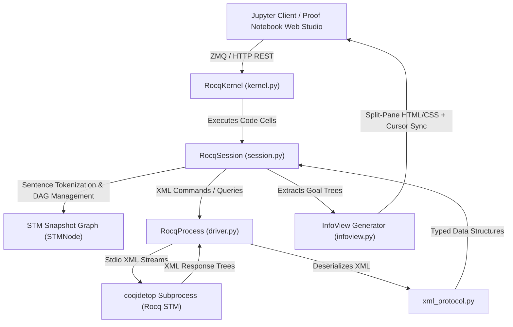

# Rocq (Coq) Jupyter Kernel Engine (`src/rocq_kernel`)

The `rocq_kernel` package implements the dedicated Rocq (formerly Coq) Jupyter Kernel and Web Studio execution engine for `proof-notebook`. It manages persistent `coqidetop` subprocesses over Coq's native XML protocol, tracks State Transaction Manager (STM) snapshots (`Stateid.t`), provides atomic rollback (`Edit_at`) and automatic cell branching, and renders interactive Split-Pane InfoViews synchronized with editor cursor movement.

---

## 1. Architecture & Component Interaction



---

## 2. Module Directory

| Module | Primary Responsibility | Key Classes & Functions |
| :--- | :--- | :--- |
| `xml_protocol.py` | Coq XML protocol encoder and decoder (`Init`, `Add`, `Edit_at`, `Goal`, `Status`, `Query`, `Quit`) | `RocqValue`, `RocqGoal`, `RocqHypothesis`, `RocqGoalsBundle`, `RocqFeedback`, `build_init_call`, `build_add_call`, `build_edit_at_call`, `build_goal_call`, `build_query_call`, `parse_xml_response` |
| `driver.py` | Persistent `coqidetop` subprocess lifecycle, XML stream framing (`</value>`), timeout & crash recovery | `RocqProcess`, `RocqDriverError`, `RocqBinaryNotFoundError`, `RocqTimeoutError`, `RocqProcessCrashedError`, `find_coqidetop_binary`, `detect_rocq_version` |
| `session.py` | Sentence tokenizer, STM state graph (`STMNode`), error rollback, and cell re-execution auto-backtracking | `RocqSession`, `STMNode`, `SentenceSpan`, `SentenceStepOutcome`, `RocqExecutionOutcome`, `tokenize_sentences`, `extract_declared_name` |
| `infoview.py` | Interactive Split-Pane InfoView HTML/CSS/JS renderer with SSR fallback and cursor synchronization | `RocqInfoViewPayload`, `RocqStepInfo`, `extract_rocq_infoview_payload`, `render_rocq_infoview_html`, `render_rocq_outcome`, `render_rocq_outcome_text` |
| `kernel.py` | `ipykernel.kernelbase.Kernel` implementation for JupyterLab, Classic Notebook, and VS Code | `RocqKernel`, `check_rocq_completeness`, `ROCQ_MAGICS` |
| `unicode_map.py` | Rocq mathematical Unicode tab-completion dictionary and vernacular/tactic completion lists | `UNICODE_ABBREVIATIONS`, `ROCQ_KEYWORDS`, `ROCQ_TACTICS` |
| `install.py` | CLI tool (`rocq-kernel`) for installing the `rocq` kernelspec and running system health diagnostics | `install_kernelspec`, `run_doctor`, `build_parser`, `main` |

---

## 3. Public Interfaces & Contracts

### 3.1 `RocqSession` (`session.py`)
- **`execute_command(code: str, cell_id: str | None = None, timeout: float | None = None) -> RocqExecutionOutcome`**:
  - Slices `code` into discrete sentences via `tokenize_sentences(code)` and expands leading proof bullets (`-`, `+`, `*`, `{`, `}`).
  - Commits each sentence sequentially via `Add` and queries active proof goals via `Goal`.
  - **Invariants**:
    1. If a sentence fails with a syntax or tactic error, `RocqSession` automatically issues `Edit_at` to roll back to the pre-cell STM state (`rollback_whole_cell_on_error=True`) or pre-sentence state, preventing state corruption.
    2. If `cell_id` was previously executed or `code` re-declares an existing identifier in `active_lineage()`, `auto_backtrack` rewinds the STM to the ancestor state prior to the previous declaration before executing the cell.
- **`inspect_symbol(symbol: str) -> str | None`**:
  - Executes `Query` with `Check <symbol>.` at `current_state_id` without mutating the STM graph.
- **`load_file(path: str | Path, fresh: bool = False) -> RocqExecutionOutcome`**:
  - Reads and evaluates a `.v` source file sentence-by-sentence.
- **`undo() -> int` / `reset(hard: bool = False) -> int`**:
  - Steps back one cell transaction or resets to `root_state_id`.

### 3.2 `RocqProcess` (`driver.py`)
- **`start() -> int`**:
  - Spawns `coqidetop -main-channel stdfds` and executes `<call val="Init"><option val="none"/></call>`, returning `root_state_id` (`1`).
- **`send_call(xml_req: str, timeout: float | None = None) -> RocqValue`**:
  - Thread-safe request/response lock. Streams stdout until the closing `</value>` tag is received and decodes into `RocqValue`.

---

## 4. Verification & Testing

```bash
# Offline unit tests (sentence tokenizer, XML protocol parser, mock driver)
.venv/bin/pytest tests/test_rocq_protocol.py -v

# Live integration tests against system coqidetop
.venv/bin/pytest tests/test_rocq_session.py -v
```
